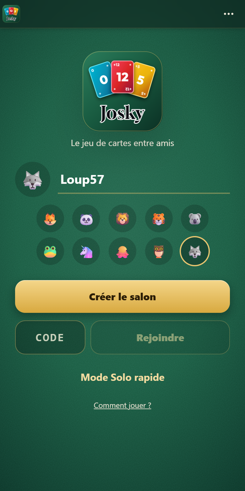
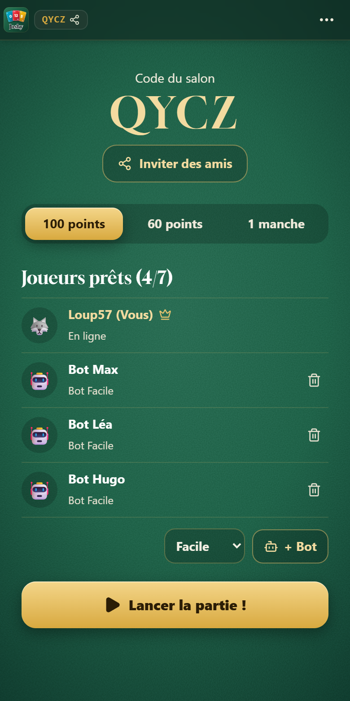
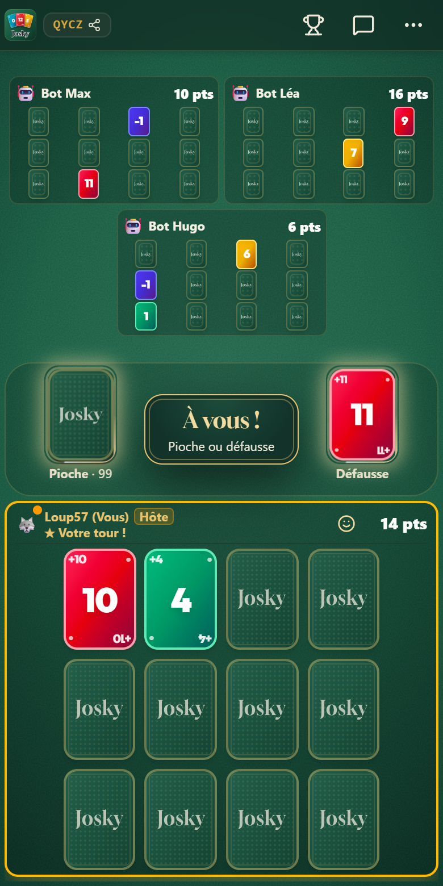

# 🃏 JoSky

Un jeu de cartes multijoueur en temps réel, pensé pour le téléphone : on crée un salon, on invite ses amis et la partie commence en quelques secondes, sans compte ni installation.

**[▶ Jouer à JoSky](https://josky-syn4.onrender.com)**

<p align="center">
  
  
  
</p>

## 🎯 Le jeu

Chaque joueur a 12 cartes, face cachée pour la plupart. À son tour, on pioche ou on prend la défausse pour obtenir le score le plus bas possible.

- Le paquet compte 150 cartes, de -2 à 12.
- Trois cartes identiques dans une colonne l'éliminent.
- Celui qui termine la manche voit ses points doublés s'il n'a pas le score le plus bas.

## ✨ Fonctionnalités

- **Multijoueur en temps réel** : salons privés avec un code court, jusqu'à 7 joueurs.
- **Invitation facile** : lien à partager, WhatsApp, SMS ou QR code.
- **Bots à 3 niveaux** : facile, normal et difficile, pour jouer seul ou compléter une table.
- **Parties robustes** : un bot prend le relais d'un joueur absent, et ce joueur peut reprendre sa place. Les salons sont sauvegardés.
- **Partie vivante** : cartes animées, réactions emoji, bulles de chat sur la table et effets sonores.
- **Tutoriel intégré** : des conseils guident la première partie.
- **Application installable** : JoSky s'ajoute à l'écran d'accueil du téléphone.
- **Statistiques** : parties, victoires et meilleur score, conservés sur l'appareil.

## 🛠️ Technique

React 19, TypeScript, Vite et Tailwind côté client ; Express et Socket.IO côté serveur. Le serveur fait autorité sur la partie et ne transmet jamais la valeur des cartes cachées.

---

## 📱 Version FiveM (lb-phone)

Une version séparée, sous forme de ressource FiveM, se trouve dans [`fivem/josky-phone`](fivem/josky-phone). Elle partage le même code de jeu. Son [README](fivem/josky-phone/README.md) détaille l'installation et les différences avec cette version web.

---

## 🚀 Déploiement sur Render.com (Gratuit)

### Méthode 1 : Blueprint automatique
1. Connectez-vous sur [dashboard.render.com](https://dashboard.render.com).
2. Cliquez sur **New +** > **Blueprint**.
3. Sélectionnez votre dépôt GitHub **`MattZepolStudio/JoSky`**.
4. Render détectera automatiquement le fichier `render.yaml` et configurera le build et le démarrage.
5. Cliquez sur **Apply** ! Votre jeu sera en ligne en quelques minutes.

### Méthode 2 : Web Service manuel
1. Dans Render, cliquez sur **New +** > **Web Service**.
2. Connectez le dépôt **`MattZepolStudio/JoSky`**.
3. Remplissez les informations suivantes :
   - **Runtime** : `Node`
   - **Build Command** : `npm install && npm run build`
   - **Start Command** : `npm start`
   - **Plan** : `Free`
4. Cliquez sur **Deploy Web Service** !

---

## 💾 Sauvegarde des parties

Render gratuit efface le disque à chaque redémarrage. Pour que les parties survivent à une mise en veille ou à un déploiement :

1. Créez une base Redis gratuite sur [upstash.com](https://upstash.com).
2. Dans Render, ajoutez `UPSTASH_REDIS_REST_URL` et `UPSTASH_REDIS_REST_TOKEN` aux variables d'environnement du service.

Sans ces variables, les parties sont écrites dans `.data/rooms.json`. Voir `.env.example` pour les autres réglages.

---

## 💻 Développement local

```bash
# Installation des dépendances
npm install

# Démarrer le serveur dev (Express + Vite + Socket.IO)
npm run dev

# Compiler pour la production
npm run build

# Tester en mode production
npm start

# Lancer les tests automatiques
npm test
```
